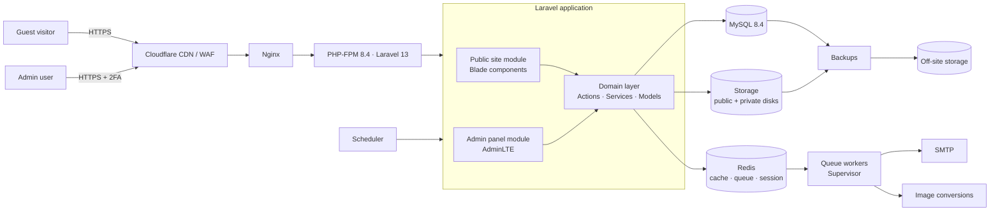
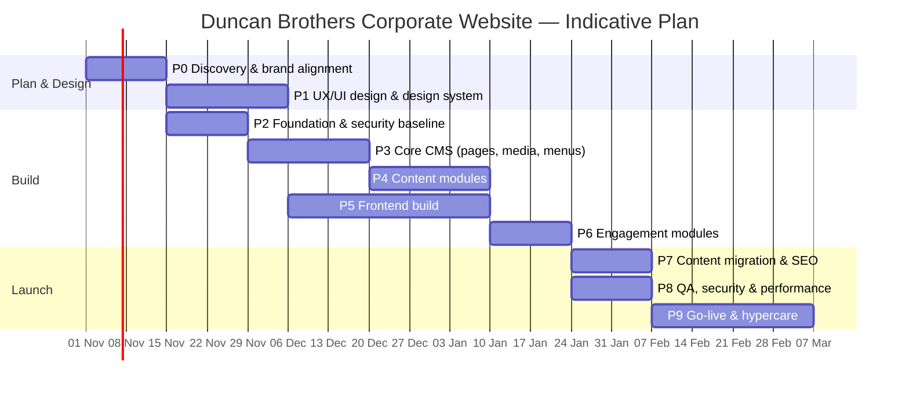

# Duncan Brothers (Bangladesh) Ltd — Corporate Website

## Architecture Guideline & Phase-wise Development Plan

| Item | Detail |
|---|---|
| Project | Corporate website re-platform for **duncanbd.com** |
| Owner | Head of Information Technology, Duncan Brothers (BD) Ltd |
| Stack | Laravel 13 · Blade · MySQL 8.4 LTS · PHP 8.4 |
| Design reference | Camellia Plc group website (camellia.plc.uk) |
| Document version | 1.0 — 11 October 2026 |
| Status | Draft for approval |

---

## Table of Contents

1. [Purpose and Objectives](#1-purpose-and-objectives)
2. [Design Reference Analysis — Camellia Plc](#2-design-reference-analysis--camellia-plc)
3. [Design System (Frontend Guideline)](#3-design-system-frontend-guideline)
4. [Information Architecture & Sitemap](#4-information-architecture--sitemap)
5. [Technology Stack](#5-technology-stack)
6. [Solution Architecture](#6-solution-architecture)
7. [Application Structure & Coding Standards](#7-application-structure--coding-standards)
8. [Admin Panel (CMS) — Functional Specification](#8-admin-panel-cms--functional-specification)
9. [Data Model](#9-data-model)
10. [Security Architecture](#10-security-architecture)
11. [Performance & Scalability](#11-performance--scalability)
12. [SEO, Accessibility & Compliance](#12-seo-accessibility--compliance)
13. [Infrastructure, DevOps & Environments](#13-infrastructure-devops--environments)
14. [Testing & Quality Assurance](#14-testing--quality-assurance)
15. [Phase-wise Development Plan](#15-phase-wise-development-plan)
16. [Team, Governance & Definition of Done](#16-team-governance--definition-of-done)
17. [Risk Register](#17-risk-register)
18. [Post-launch Roadmap](#18-post-launch-roadmap)
19. [Appendices](#19-appendices)

---

## 1. Purpose and Objectives

### 1.1 Purpose
Replace the current duncanbd.com with a secure, maintainable, content-managed corporate website whose look and feel is aligned with the Camellia Plc group identity, so that Duncan Brothers presents as a recognisable member of the Camellia family while telling its own Bangladesh story (tea, rubber, warehousing, people and communities).

### 1.2 Business Objectives
| # | Objective | Measure of success |
|---|---|---|
| O1 | Group-consistent brand presence | Design signed off by Duncan management and checked against Camellia brand guidelines |
| O2 | Self-service content management | Non-technical staff can publish pages, news, documents and media without developer help |
| O3 | Reliable shareholder / stakeholder disclosure | Annual reports, AGM notices and statutory documents published with dates, versions and audit trail |
| O4 | International-standard quality | WCAG 2.2 AA, OWASP ASVS Level 2, Core Web Vitals "Good" on mobile |
| O5 | Recruitment & enquiries | Online job applications and categorised enquiries routed to the right inbox |
| O6 | Zero SEO loss on migration | 100 % of indexed legacy URLs 301-redirected; no rise in 404s after launch |

### 1.3 Scope
**In scope:** public website, admin panel (CMS), document & media library, news, careers, enquiries, settings, user/role management, audit logging, SEO tooling, content migration, hosting set-up, training and handover.

**Out of scope (Phase 1 release):** e-commerce, employee intranet/portal, ERP integration, native mobile apps. These are listed in the [Post-launch Roadmap](#18-post-launch-roadmap).

### 1.4 Guiding Principles
1. **Content first** — every page type is designed around real content, not lorem ipsum.
2. **Secure by default** — least privilege, 2FA for every admin, nothing public until published.
3. **Convention over invention** — standard Laravel patterns so any competent Laravel developer can maintain it.
4. **Brand-aligned, not cloned** — follow the group's visual language; never copy Camellia's code, images or text.
5. **Accessible and fast for everyone** — including users on mobile data in rural Bangladesh.

---

## 2. Design Reference Analysis — Camellia Plc

A review of camellia.plc.uk (October 2026) identified the following reusable patterns. These become the blueprint for the Duncan Brothers frontend.

### 2.1 Global Elements
| Element | Camellia pattern | Duncan Brothers adaptation |
|---|---|---|
| Brand colour | Deep navy (`theme-color #2c3f5c`) | Use the same navy as primary to signal group membership |
| Utility bar | Thin top bar with share price, search, social links | "A Camellia Group company" link, search, language toggle (EN/বাংলা — future), social links |
| Primary navigation | Logo + an **"Explore"** button opening a full-screen overlay menu with two link columns | Same overlay pattern, with Duncan's sections (see §4) |
| Insignia | Camellia emblem used as a decorative device on inner page headers | Use only with written group approval; otherwise a Duncan leaf/estate motif |
| Footer | Logo, postal address, phone/email, social icons, "Our reports" links, legal links (Privacy, Cookie, Terms, Modern Slavery), copyright, scroll-to-top | Same structure with Dhaka/Chattogram addresses and Duncan's legal/policy documents |
| Newsletter | "Receive investor relation news" sign-up band above footer | "Receive news & updates" sign-up with double opt-in |

### 2.2 Homepage Composition (top to bottom)
1. **Full-bleed hero** — rotating large landscape photographs of estates/operations with a short H1 tagline.
2. **Quick-link tiles** — 4–5 tiles (What we do · Our team · Investors · Governance · Sustainability).
3. **Investor updates block** — featured report with cover thumbnail and "Open report" button, a "Latest reports" list, and a "View all reports" link.
4. **Key-figure strip** — 3 large statistics (e.g., year established, number of companies, hectares farmed).
5. **Purpose statement** — one paragraph with key values in bold, plus two buttons.
6. **Embedded corporate video.**
7. **Group News** — 3 news cards with month-year label and an "All News" link.
8. **Newsletter band → Footer.**

### 2.3 Inner Page Pattern ("What we do")
- Page title + a large one-sentence intro statement.
- Content sections separated by generous white space.
- **Operating-company cards** that expand to show a description and two headline metrics (hectares, revenue) with a "Find out more" link.
- **Logo strip** of group companies linking to their sites.
- Closing statement band.

### 2.4 Content We Can Reuse (with attribution)
The Camellia group site describes Duncan Brothers as operating **14 tea factories** producing CTC teas plus **two rubber processing plants** on roughly **9,000 ha**, and features a May 2026 story on the **Chattogram warehouse development**. These are natural candidates for Duncan's own key-figure strip and news — figures must be confirmed with Finance before publication.

> **Action (Phase 0):** Request the official Camellia Group brand guidelines, logo files, colour codes and typography from the group communications team, and written permission for any use of the Camellia name, insignia or photography.

---

## 3. Design System (Frontend Guideline)

All values below are implemented as CSS custom properties (design tokens) in a single SCSS file so the whole site can be re-themed in one place. Values marked **(proposed)** must be replaced with the official group brand values once received.

### 3.1 Colour Tokens
| Token | Value | Use |
|---|---|---|
| `--color-primary` | `#2C3F5C` | Header, footer, headings, primary buttons (confirmed from Camellia site) |
| `--color-primary-dark` | `#1E2C41` (proposed) | Hover states, overlay menu background |
| `--color-accent` | `#5E8C4A` tea green (proposed) | Links, highlights, key-figure numbers |
| `--color-accent-warm` | `#C8A15A` (proposed) | Sparing decorative accents, dividers |
| `--color-surface` | `#FFFFFF` | Page background |
| `--color-surface-alt` | `#F4F5F2` (proposed) | Alternating section backgrounds |
| `--color-text` | `#1F2933` | Body text (contrast ≥ 7:1 on white) |
| `--color-text-muted` | `#5B6670` | Captions, metadata (contrast ≥ 4.5:1) |
| `--color-focus` | `#F2B705` | Keyboard focus ring (3 px) |

Every foreground/background pair must pass WCAG 2.2 AA contrast (4.5:1 text, 3:1 large text and UI components).

### 3.2 Typography
| Role | Proposed font | Size (desktop / mobile) |
|---|---|---|
| Display / H1 | Serif — group font if supplied; fallback *Playfair Display* or *Libre Baskerville* | 56 / 36 px |
| H2 | Same serif | 40 / 28 px |
| H3–H5 | Sans-serif — group font; fallback *Inter* or *Source Sans 3* | 28–18 px |
| Body | Sans-serif | 18 / 16 px, line-height 1.6 |
| Bangla (future) | *Noto Sans Bengali* / *Hind Siliguri* | Matched x-height |

Fonts are **self-hosted** (WOFF2, `font-display: swap`, preloaded) — no runtime calls to third-party font CDNs.

### 3.3 Layout & Spacing
- 12-column grid, max content width **1280 px**, full-bleed sections allowed.
- 8 px spacing scale (`--space-1` = 8 px … `--space-12` = 96 px). Section padding: 96 px desktop / 56 px mobile.
- Breakpoints: 576 / 768 / 992 / 1200 / 1400 px (Bootstrap 5 defaults).
- Mobile-first build.

### 3.4 Component Library (Blade components)
Each component lives in `resources/views/components/` and is the **only** way a pattern is rendered, so admin page blocks and hard-coded templates stay visually identical.

| Component | Notes |
|---|---|
| `<x-site.utility-bar>` | Group link, search, socials |
| `<x-site.header>` / `<x-site.explore-menu>` | Overlay menu; focus-trapped, `Esc` closes, `aria-expanded` |
| `<x-hero.slider>` | Max 5 slides, pause control (WCAG 2.2.2), honours `prefers-reduced-motion` |
| `<x-hero.page>` | Inner page title + intro statement + optional image |
| `<x-tiles.quick-links>` | 3–5 tiles |
| `<x-stats.strip>` | Animated count-up only when motion allowed |
| `<x-cards.news>` / `<x-cards.business>` / `<x-cards.person>` | Consistent image ratios (16:9, 4:3, 1:1) |
| `<x-accordion.company>` | Expandable business/estate cards with metrics |
| `<x-documents.featured>` / `<x-documents.list>` | Cover, title, date, size, file type, download |
| `<x-media.video>` | Click-to-load YouTube (privacy-enhanced `youtube-nocookie.com`) |
| `<x-media.gallery>` | Lightbox, keyboard-navigable |
| `<x-cta.band>` / `<x-newsletter.band>` | Calls to action |
| `<x-site.footer>` / `<x-site.cookie-banner>` | Footer + consent |
| `<x-ui.breadcrumb>` / `<x-ui.pagination>` / `<x-ui.button>` | Utilities |

### 3.5 Imagery Guidelines
- Use **Duncan's own photography** of Bangladesh estates, factories, people and communities. Commission a professional shoot in Phase 1 if the library is thin.
- Hero images ≥ 2400 px wide, landscape, natural light, no heavy filters — matching the Camellia documentary style.
- Model/property releases held for identifiable people; alt text mandatory in the CMS.

---

## 4. Information Architecture & Sitemap

> Final labels and pages to be validated in the Phase 0 content audit of the current duncanbd.com.

```
Home
├── Who we are
│   ├── About Duncan Brothers
│   ├── Our history (interactive timeline, 1859 → today)
│   ├── Camellia Group
│   ├── Leadership & Board
│   └── Corporate governance
│       ├── Policies (Code of Conduct, Whistleblowing, Anti-bribery, Modern Slavery, etc.)
│       └── Group guiding principles
├── What we do
│   ├── Tea
│   │   ├── Our estates (listing → estate detail pages)
│   │   └── Factories & quality
│   ├── Rubber
│   ├── Warehousing (Chattogram)
│   └── Group companies (e.g., Eastland Camellia Ltd)
├── Sustainability
│   ├── Environment
│   ├── People & communities (health, education, housing, welfare)
│   ├── Certifications
│   └── Sustainability reports
├── Investors & Shareholders
│   ├── Annual & interim reports
│   ├── AGM / EGM notices & minutes
│   ├── Price-sensitive / statutory disclosures (if applicable)
│   └── Shareholder information & contacts
├── News & Media
│   ├── News
│   ├── Press releases
│   ├── Photo gallery
│   └── Videos
├── Careers
│   ├── Working at Duncan Brothers
│   ├── Current vacancies → vacancy detail → apply
│   └── Graduate / trainee programme
├── Contact
│   ├── Offices (Dhaka, Chattogram, Sylhet region) with maps
│   └── Enquiry form (routed by category)
└── Legal (footer)
    ├── Privacy notice · Cookie policy · Terms of use
    ├── Accessibility statement
    └── HTML sitemap
```

### 4.1 URL Conventions
- Lower-case, hyphenated, human-readable: `/what-we-do/tea/estates/{estate-slug}`.
- Trailing slash consistent (choose **no trailing slash**, enforce via middleware).
- News: `/news/{yyyy}/{slug}`; documents: `/documents/{category}/{slug}` → file served via `/download/{uuid}`.
- Future Bangla: `/bn/...` prefix with `hreflang` alternates.

---

## 5. Technology Stack

| Layer | Choice | Rationale |
|---|---|---|
| Language | **PHP 8.4** (8.3 minimum) | Laravel 13 requires PHP 8.3+ |
| Framework | **Laravel 13.x** | Current major release; bug fixes to Q3 2027, security fixes to Q1 2028 — plan upgrade to Laravel 14 within that window |
| Templating | Blade + Blade components | Server-rendered = fast first paint, simple SEO |
| Interactivity | **Alpine.js** (frontend), optional **Livewire 3** (admin tables/forms) | Light, no SPA complexity |
| CSS | **Bootstrap 5.3** + SCSS design tokens | Shared knowledge with AdminLTE; one toolchain |
| Admin UI | **AdminLTE 4** (Bootstrap 5) | Proven, familiar, free, consistent with existing in-house builds |
| Build | **Vite** (two entry points: `site` and `admin`) | Laravel default |
| Database | **MySQL 8.4 LTS** (InnoDB, `utf8mb4_0900_ai_ci`) | Requirement; full Bangla Unicode support |
| Cache / Queue / Session | **Redis 7** | Fast cache, reliable queues; fallback to `database` driver on small hosts |
| Search | Laravel Scout + **MySQL full-text** (database engine) | No extra service; upgrade path to Meilisearch |
| Rich text editor | **TinyMCE** (self-hosted) or **CKEditor 5** | Confirm licence terms before selection |
| Mail | SMTP via company mail / transactional provider | Queued delivery |

### 5.1 Key Packages
| Package | Purpose |
|---|---|
| `laravel/fortify` | Login, password reset, **two-factor authentication** (Blade views) |
| `spatie/laravel-permission` | Roles & permissions |
| `spatie/laravel-medialibrary` | Media handling, responsive images, WebP/AVIF conversions |
| `spatie/laravel-activitylog` | Audit trail |
| `spatie/laravel-sitemap` | XML sitemap generation |
| `spatie/laravel-responsecache` | Full-page cache for guest visitors |
| `spatie/laravel-backup` | Database + file backups to off-site storage |
| `spatie/laravel-honeypot` | Spam protection on public forms |
| `spatie/laravel-csp` | Content-Security-Policy headers |
| `spatie/laravel-translatable` | Multilingual fields (future Bangla) |
| `mews/purifier` | HTML sanitisation of rich-text input |
| `artesaos/seotools` (or custom) | Meta, Open Graph, JSON-LD |
| Dev: `laravel/pint`, `larastan/larastan`, `pestphp/pest`, `laravel/telescope` (local only), `barryvdh/laravel-debugbar` (local only) | Quality tooling |

> **Rule:** every third-party package must be actively maintained, licence-compatible (MIT/BSD/Apache or a licence you have bought), and pass `composer audit`.

---

## 6. Solution Architecture

### 6.1 Logical Architecture



### 6.2 Architectural Style
**Modular monolith** — one Laravel application, one database, but code organised into clearly bounded modules (CMS, Media, Documents, News, Business, Careers, Enquiries, Settings, Identity). Benefits: simple deployment and hosting, while keeping the code easy to reason about and test. No microservices are justified at this scale.

### 6.3 Request Flow
| Visitor type | Flow |
|---|---|
| Guest | CDN cache → Nginx → response cache hit (Redis) → served in < 50 ms. On miss: controller → query (eager loaded) → Blade → cached. |
| Admin | Bypasses CDN cache (`/admin*` no-cache) → auth + 2FA middleware → permission policy → action class → DB transaction → audit log → cache tags invalidated → queued jobs (image conversions, sitemap rebuild). |

### 6.4 Publishing Workflow
```
Draft ──▶ In review ──▶ Approved ──▶ Scheduled ──▶ Published ──▶ Archived
   ▲            │                                     │
   └── Changes requested ◀────────────────────────────┘ (new revision)
```
- Every save creates a **revision** (who, when, diff); any revision can be previewed or restored.
- **Preview** uses a time-limited signed URL so reviewers see drafts without publishing.
- **Scheduled publishing/unpublishing** runs via the Laravel scheduler every minute.
- Publishing clears the relevant response-cache tags and pings the sitemap rebuild job.

### 6.5 Page Builder (Block Model)
Pages are composed of ordered, typed **blocks** stored as JSON (`pages.blocks`), each mapping 1-to-1 to a Blade component:

`hero` · `rich_text` · `quick_links` · `stats` · `cards_grid` · `company_accordion` · `featured_document` · `document_list` · `news_feed` · `video` · `gallery` · `timeline` · `people_grid` · `cta_band` · `accordion_faq` · `map`

Each block type has: a **schema class** (fields + validation rules), an **admin form partial**, and a **frontend component**. A `schema_version` per block allows safe migrations later. This gives editors flexibility while keeping the design system intact — editors choose blocks, never raw layout.

---

## 7. Application Structure & Coding Standards

### 7.1 Directory Layout
```
app/
├── Domain/
│   ├── Cms/            (Page, Block, Menu, Revision, Redirect)
│   ├── Media/          (MediaFolder, conversions)
│   ├── Documents/      (Document, DocumentCategory, DocumentVersion)
│   ├── News/           (Post, Category, Tag)
│   ├── Business/       (Business, Estate, KeyFigure, TimelineEvent)
│   ├── People/         (Person, Board, Team)
│   ├── Careers/        (Vacancy, Application)
│   ├── Engagement/     (Enquiry, Subscriber)
│   ├── Settings/       (Setting, SettingsRepository)
│   └── Identity/       (User, Role policies)
│       each with: Models/ Actions/ Data/ Enums/ Policies/ Events/ Observers/
├── Http/
│   ├── Controllers/Site/     (public, thin)
│   ├── Controllers/Admin/    (admin, thin)
│   ├── Requests/Admin/       (FormRequest validation)
│   └── Middleware/
├── View/Components/          (Blade component classes)
├── Jobs/  Mail/  Notifications/  Console/
resources/
├── views/site/   views/admin/   views/components/   views/mail/
├── scss/site/    scss/admin/    js/site/   js/admin/
routes/
├── web.php   (public)   admin.php   (prefixed, auth + 2fa)   console.php
database/
├── migrations/   seeders/   factories/
tests/
├── Feature/{Module}/   Unit/   Browser/
```

### 7.2 Standards
| Area | Standard |
|---|---|
| Code style | PSR-12 via **Laravel Pint** (enforced in CI) |
| Static analysis | **Larastan level 6** minimum, level 8 target |
| Controllers | Thin: validate (FormRequest) → call **Action** → return view/redirect |
| Business logic | Single-purpose Action classes (`PublishPage`, `UploadDocument`) |
| Authorisation | Policies on every model; `authorize()` in every admin action |
| Queries | Eager loading; `Model::preventLazyLoading()` in non-production |
| Enums | PHP backed enums for statuses, roles, categories |
| Config | No hard-coded values; site settings from DB, secrets from `.env` |
| Git | Trunk-based with short-lived feature branches; Conventional Commits; PR review required |
| Docs | README, `/docs` ADRs (Architecture Decision Records), admin user manual |

---

## 8. Admin Panel (CMS) — Functional Specification

Admin URL: a non-obvious path (e.g. `/dbbd-console`) configurable via `.env`, optionally IP-restricted to office/VPN ranges.

### 8.1 Modules
| # | Module | Key functions |
|---|---|---|
| 1 | **Dashboard** | Recent activity, drafts awaiting review, new enquiries/applications, storage usage, quick links |
| 2 | **Pages** | Block-based page builder, hierarchy (parent/child), templates, SEO tab, revisions, preview, schedule |
| 3 | **Menus** | Drag-and-drop header "Explore" menu, footer columns, legal links |
| 4 | **Homepage** | Hero slides, quick-link tiles, key figures, featured report, purpose statement, video |
| 5 | **News & Media** | Posts, press releases, categories/tags, featured image, gallery albums, videos |
| 6 | **Businesses & Estates** | Business units, estate profiles (location, area, factory, certifications, photos, map pin) |
| 7 | **People** | Board, leadership, bios, photos, display order |
| 8 | **History timeline** | Year, title, text, image |
| 9 | **Sustainability** | Initiatives, metrics, certifications, reports |
| 10 | **Documents library** | Categories (Annual Report, AGM, Policy, Sustainability…), financial year, versions, publish/expiry dates, cover image, public/private, download counter |
| 11 | **Media library** | Folders, bulk upload, drag-and-drop, crop/focal point, alt text (mandatory), usage tracking ("where is this used?"), auto WebP/AVIF |
| 12 | **Careers** | Vacancies (department, location, closing date), applications inbox, CV download (private storage), status pipeline, CSV export, auto-close on deadline |
| 13 | **Enquiries** | Contact submissions by category, assignment, status, routing rules per category email |
| 14 | **Subscribers** | Newsletter list, double opt-in, export, unsubscribe log |
| 15 | **SEO** | Global defaults, per-page meta, OG image, **301/302 redirect manager**, 404 log, robots.txt editor, sitemap regenerate |
| 16 | **Settings** | Site identity (logo, favicon), contact details, addresses, social links, footer text, analytics ID, cookie banner text, SMTP, maintenance mode, group link |
| 17 | **Users & Roles** | Users, roles, permission matrix, 2FA status, force password reset, deactivate |
| 18 | **Audit log** | Who did what, when, from which IP; filter and export |
| 19 | **System** | Cache clear, queue status, backup status/download, health checks |
| 20 | **Translations** *(future)* | EN/বাংলা strings and content |

### 8.2 Roles & Permissions (initial matrix)
| Capability | Super Admin | Site Admin | Editor | Author | IR / Co. Secretary | HR | Viewer |
|---|---|---|---|---|---|---|---|
| Users, roles, system settings | ✅ | — | — | — | — | — | — |
| Site settings, menus, SEO | ✅ | ✅ | — | — | — | — | — |
| Pages / homepage — publish | ✅ | ✅ | ✅ | — | — | — | — |
| Pages / news — create & edit drafts | ✅ | ✅ | ✅ | ✅ | — | — | — |
| Documents — investor/statutory | ✅ | ✅ | — | — | ✅ | — | — |
| Documents — general | ✅ | ✅ | ✅ | — | ✅ | — | — |
| Media library | ✅ | ✅ | ✅ | ✅ | ✅ | ✅ | view |
| Careers & applications | ✅ | ✅ | — | — | — | ✅ | — |
| Enquiries | ✅ | ✅ | ✅ | — | ✅ | ✅ | view |
| Audit log | ✅ | ✅ | — | — | — | — | — |

Permissions are granular (`pages.publish`, `documents.investor.manage`, …); roles are bundles, editable by Super Admin.

### 8.3 Admin UX Requirements
- Server-side paginated, searchable, sortable tables with bulk actions.
- Unsaved-changes warning; autosave drafts every 60 s.
- Inline validation messages; success/failure toasts.
- Every list has filters for status, author, date.
- Admin panel usable on a tablet; WCAG 2.2 AA for admin forms too.

---

## 9. Data Model

### 9.1 Core Tables
| Table | Key columns |
|---|---|
| `users` | id, name, email, password, two_factor_secret, two_factor_confirmed_at, is_active, last_login_at, last_login_ip |
| `roles`, `permissions`, `model_has_roles`, … | (spatie/laravel-permission) |
| `pages` | id, parent_id, title, slug, template, blocks (JSON), status, published_at, unpublish_at, seo (JSON), author_id, sort_order, timestamps, soft deletes |
| `revisions` | id, revisionable_type, revisionable_id, payload (JSON), user_id, note, created_at |
| `menus`, `menu_items` | location; label, url / page_id, parent_id, order, target, is_active |
| `hero_slides` | title, subtitle, media_id, cta_label, cta_url, order, is_active |
| `key_figures` | label, value, suffix, context, order |
| `posts` | type (news/press), title, slug, excerpt, body, featured_media_id, status, published_at, seo, author_id |
| `categories`, `taggables`, `tags` | polymorphic taxonomy |
| `businesses` | name, slug, summary, body, metrics (JSON), logo_id, website_url, order |
| `estates` | business_id, name, slug, district, area_ha, factory, certifications (JSON), lat, lng, body, order |
| `people` | name, slug, position, group (board/leadership), bio, photo_id, order |
| `timeline_events` | year, title, body, media_id, order |
| `documents` | uuid, category_id, title, slug, description, financial_year, document_date, visibility (public/private), status, published_at, expires_at, cover_media_id, download_count |
| `document_versions` | document_id, version, file path (private disk), mime, size, checksum (SHA-256), uploaded_by, is_current |
| `document_categories` | name, slug, parent_id, order |
| `media` / `media_folders` | (spatie/medialibrary) + alt_text, caption, credit, folder_id |
| `vacancies` | title, slug, department, location, employment_type, description, requirements, closing_date, status |
| `applications` | vacancy_id, name, email, phone, cover_letter, cv_path (private), status, consent_at, ip |
| `enquiries` | category, name, email, phone, organisation, message, status, assigned_to, ip, user_agent |
| `subscribers` | email, status, confirmed_at, unsubscribed_at, token |
| `redirects` | from_path (unique), to_url, status_code, hits, last_hit_at |
| `settings` | group, key, value (JSON), is_encrypted |
| `activity_log` | (spatie/activitylog) |
| `not_found_log` | path, referrer, hits, last_seen_at |

### 9.2 Data Rules
- `utf8mb4` everywhere; all timestamps stored **UTC**, displayed in **Asia/Dhaka**.
- Soft deletes on all content; hard delete only by Super Admin after 30 days.
- Slugs unique per scope and immutable once published (a changed slug auto-creates a 301 redirect).
- Personal data (applications, enquiries, subscribers) has a **retention policy** (e.g., applications deleted 12 months after vacancy closes) enforced by a scheduled job.

---

## 10. Security Architecture

Target: **OWASP ASVS 4.0 Level 2** and the **OWASP Top 10**.

| Domain | Controls |
|---|---|
| Authentication | Fortify; **mandatory TOTP 2FA** for all admin users; recovery codes; password min 12 chars + breach check (`Password::uncompromised()`); lockout after 5 failures; session timeout 30 min idle |
| Authorisation | Policies on every model and admin route; deny by default; Super Admin limited to ≤ 2 named people |
| Admin exposure | Custom admin path; optional IP allowlist / VPN; separate rate limiter; `noindex` |
| Input / output | FormRequest validation everywhere; Blade auto-escaping; rich text sanitised with HTMLPurifier allow-list; no raw `{!! !!}` except purified fields |
| File uploads | Allow-list of extensions **and** MIME sniffing; size limits; random filenames; stored outside web root for private files; optional ClamAV scan job; images re-encoded on upload (strips EXIF/malicious payloads) |
| Downloads | Private documents and CVs served through controller with policy check / signed URL; `Content-Disposition: attachment` |
| Forms | CSRF; honeypot + time-trap; rate-limited (e.g., 5/min/IP); optional Cloudflare Turnstile |
| Transport | TLS 1.2+ only, HSTS (with preload after stabilisation), HTTP→HTTPS redirect |
| Headers | CSP (nonce-based), `X-Content-Type-Options`, `Referrer-Policy: strict-origin-when-cross-origin`, `Permissions-Policy`, `X-Frame-Options: SAMEORIGIN` |
| Secrets | `.env` never committed; `APP_DEBUG=false` in production; encrypted settings for SMTP passwords; key rotation procedure documented |
| Logging | Audit log for all admin create/update/delete/publish/login; failed logins; logs shipped off-server; 1-year retention |
| Dependencies | `composer audit` + `npm audit` in CI; Dependabot/Renovate; monthly patch window |
| Backups | Daily DB + weekly full; encrypted; off-site; 3-2-1 rule; **quarterly restore test** |
| Testing | OWASP ZAP baseline scan in CI on staging; independent penetration test before go-live |

---

## 11. Performance & Scalability

### 11.1 Targets (mobile, 75th percentile)
| Metric | Target |
|---|---|
| Largest Contentful Paint (LCP) | < 2.5 s |
| Interaction to Next Paint (INP) | < 200 ms |
| Cumulative Layout Shift (CLS) | < 0.1 |
| Time to First Byte (cached) | < 200 ms |
| Lighthouse Performance / Accessibility / Best Practices / SEO | ≥ 90 / 100 / 100 / 100 |
| Homepage weight | < 1.5 MB on first load |

### 11.2 Techniques
- **Full-page response cache** for guests (Redis, tag-based invalidation on publish).
- **CDN** (Cloudflare) for static assets with long-lived immutable hashes from Vite.
- **Responsive images**: `srcset` + WebP/AVIF conversions generated by queued jobs; LCP hero image preloaded, others lazy-loaded; explicit width/height to avoid CLS.
- Query optimisation: eager loading, indexes on `slug`, `status`, `published_at`; query count budget ≤ 15 per page.
- Config/route/view/event caching in deploy (`php artisan optimize`).
- OPcache + JIT enabled; PHP-FPM tuned to server RAM.
- Minimal JavaScript (Alpine.js); no jQuery on the public site.
- Video embeds load only on click (facade pattern).

---

## 12. SEO, Accessibility & Compliance

### 12.1 SEO
- Unique `<title>` and meta description per page (editable, with defaults and length hints).
- Open Graph + Twitter cards; default share image.
- **JSON-LD**: `Organization` (with `parentOrganization` → Camellia Plc), `WebSite` + `SearchAction`, `BreadcrumbList`, `NewsArticle`, `JobPosting` (for vacancies).
- Auto-generated `sitemap.xml` (pages, news, estates, vacancies, documents) + `robots.txt`.
- Canonical URLs; one `<h1>` per page; semantic HTML5 landmarks.
- **Migration**: crawl the legacy site (Screaming Frog), build a full old→new **301 map**, import into the redirect manager, monitor 404 log and Google Search Console for 8 weeks post-launch.
- `hreflang` when Bangla is added.

### 12.2 Accessibility — WCAG 2.2 AA
- Keyboard-operable navigation including the overlay menu (focus trap, `Esc` to close, visible focus).
- Skip-to-content link; logical heading order; landmarks.
- Alt text mandatory in the CMS (decorative images flagged explicitly).
- Slider: pause/stop control, no auto-advance faster than 5 s, honours reduced motion.
- Forms: visible labels, error summaries, `aria-describedby` for errors.
- Documents: encourage tagged/accessible PDFs; show file type and size on every link.
- Published **Accessibility Statement**.

### 12.3 Privacy & Legal
- Cookie consent banner with **Accept / Reject / Preferences** — analytics loads only after consent.
- Privacy Notice covering enquiries, applications, newsletter; consent checkbox + timestamp stored.
- Data-subject requests (access/erasure) handled through admin export/delete tools.
- Align with applicable **Bangladesh data-protection and ICT law** and **Camellia Group privacy standards** (UK GDPR-aligned) — to be confirmed with Legal/Company Secretary.
- If any group entity's shares are listed in Bangladesh, confirm website disclosure obligations (annual reports, AGM notices, price-sensitive information) with the Company Secretary and design the Investors section to meet them.
- Group policies (Code of Conduct, Modern Slavery Statement, Whistleblowing) published consistently with Camellia.

---

## 13. Infrastructure, DevOps & Environments

### 13.1 Environments
| Env | Purpose | Data | Access |
|---|---|---|---|
| Local | Development (Laravel Herd / Sail / Docker) | Seeders + anonymised dump | Developers |
| Staging | UAT, content entry before launch, security scans | Copy of production (PII anonymised) | Internal, password/IP protected, `noindex` |
| Production | Live site | Live | Public + admins |

### 13.2 Production Hosting (recommended baseline)
| Component | Specification |
|---|---|
| Server | Cloud VM (e.g., AWS Lightsail/EC2 Singapore or Mumbai, DigitalOcean Singapore, or reputable BD data centre) — **4 vCPU, 8 GB RAM, 160 GB SSD** |
| OS | Ubuntu 24.04 LTS, unattended security upgrades |
| Web | Nginx + PHP-FPM 8.4 + OPcache |
| DB | MySQL 8.4 LTS (same host initially; managed DB optional later) |
| Cache/queue | Redis 7 |
| Processes | Supervisor for queue workers; cron for `schedule:run` |
| Edge | Cloudflare (DNS, CDN, WAF, DDoS, Turnstile) |
| TLS | Cloudflare Full (Strict) + origin certificate |
| Backups | spatie/laravel-backup → S3-compatible off-site bucket + server snapshots |
| Monitoring | Uptime (e.g., UptimeRobot/Better Stack), error tracking (Sentry or Flare), Laravel Pulse for server health |

Region choice should balance latency to Bangladesh visitors with group/international audiences; Singapore is typically a good compromise.

### 13.3 CI/CD Pipeline (GitHub Actions)
```
Push / PR ─▶ Install deps ─▶ Pint (style) ─▶ Larastan ─▶ Pest tests (+ coverage)
         ─▶ composer audit / npm audit ─▶ Vite build ─▶ ✅ merge allowed
Merge to main ─▶ Deploy to Staging (zero-downtime) ─▶ ZAP baseline + Lighthouse CI
Tagged release ─▶ Manual approval ─▶ Deploy to Production ─▶ Smoke tests ─▶ Notify
```
- Zero-downtime deploys via **Deployer** or **Laravel Envoy** (release folders + symlink switch); `php artisan migrate --force`, `optimize`, `queue:restart`.
- Rollback = switch symlink to previous release (< 1 min).
- Database migrations must be backward-compatible for one release.

---

## 14. Testing & Quality Assurance

| Level | Tooling | Coverage expectation |
|---|---|---|
| Unit | Pest | Actions, services, value objects |
| Feature | Pest (HTTP tests) | Every admin CRUD, every permission boundary, every public route returns 200/404 correctly |
| Browser / E2E | Pest browser testing or Laravel Dusk | Login + 2FA, publish page, upload document, submit enquiry, apply for job, overlay menu keyboard nav |
| Accessibility | axe-core in CI + manual NVDA/VoiceOver checks | Zero critical/serious issues |
| Performance | Lighthouse CI, k6 load test | Targets in §11; 200 concurrent users with p95 < 1 s uncached |
| Security | OWASP ZAP, external pen test | No high/critical findings open at launch |
| Cross-browser | Latest 2 versions Chrome, Edge, Safari, Firefox; iOS Safari; Android Chrome | Visual parity |
| UAT | Business users with scripted scenarios | Sign-off per module |

Minimum automated test coverage: **70 %** of domain/action code.

---

## 15. Phase-wise Development Plan

**Indicative duration: ~22 weeks** (≈ 5 months) with a team of 1 lead/full-stack developer, 1 developer, 1 UI/UX designer (part-time), 1 QA (part-time), plus a content owner from Corporate Affairs. Phases overlap where shown.

### Timeline Overview


---

### Phase 0 — Discovery & Brand Alignment (Weeks 1–2)
**Goal:** agree what we are building and secure inputs.

| Activities | Deliverables |
|---|---|
| Stakeholder interviews (MD, Corporate Affairs, Company Secretary, HR, IT) | Requirements & priorities document |
| Content audit & URL inventory of current duncanbd.com (crawl all URLs, PDFs, images) | Content inventory spreadsheet; legacy URL list |
| Request Camellia brand guidelines, logos, colours, fonts, usage permissions | Brand pack + approval email |
| Confirm statutory/investor disclosure needs | Disclosure checklist |
| Hosting, domain, DNS, email (SMTP) decisions | Infrastructure decision record |
| Define roles & approval workflow | Approved RACI + permission matrix |

**Exit criteria:** sitemap (§4) and scope signed off; brand pack received; hosting chosen.

---

### Phase 1 — UX/UI Design & Design System (Weeks 3–5)
**Goal:** a signed-off visual design aligned with the Camellia group look.

| Activities | Deliverables |
|---|---|
| Wireframes: home, inner page, What we do, estate detail, news list/detail, documents, careers, contact, search, 404 | Clickable wireframes (Figma) |
| Design tokens & component library (§3) | Figma design system |
| High-fidelity mockups (desktop + mobile) | Approved mockups |
| Accessibility review of designs (contrast, focus, motion) | Accessibility design checklist |
| Photography brief / shoot plan | Shot list |
| Admin panel wireframes for page builder & document library | Admin UX flows |

**Exit criteria:** management and (if required) group communications approve the designs.

---

### Phase 2 — Foundation & Security Baseline (Weeks 3–4, parallel with Phase 1)
**Goal:** a secure, deployable skeleton.

| Activities | Deliverables |
|---|---|
| Laravel 13 project, module structure (§7), Pint, Larastan, Pest | Repository with CI green |
| Environments: local, staging server, Cloudflare, TLS | Staging URL live |
| Fortify auth + **mandatory 2FA**, password policy, lockout | Secure admin login |
| spatie/permission roles & seed matrix | Roles and policies |
| AdminLTE 4 admin shell, layout, navigation, dashboard placeholder | Admin shell |
| Settings module (site identity, contacts, social, SMTP) | Settings UI |
| Audit log, security headers, CSP, backups, error tracking | Baseline controls |
| Zero-downtime deploy script | One-command deploy to staging |

**Exit criteria:** admin can log in with 2FA on staging; CI pipeline enforces quality gates; backup restore tested once.

---

### Phase 3 — Core CMS (Weeks 5–7)
**Goal:** editors can build and publish pages.

| Activities | Deliverables |
|---|---|
| Media library (folders, upload, alt text, conversions, usage tracking) | Media module |
| Page module with block builder (all block types in §6.5) | Page builder |
| Revisions, preview (signed URLs), scheduling, workflow statuses | Publishing workflow |
| Menu manager (Explore overlay + footer) | Menus module |
| SEO fields, redirect manager, 404 log, sitemap job | SEO module |
| Response-cache with tag invalidation | Caching layer |

**Exit criteria:** an editor can create, review, schedule and publish a multi-block page end-to-end; feature tests pass.

---

### Phase 4 — Content Modules (Weeks 8–10)
**Goal:** all structured content types available.

| Activities | Deliverables |
|---|---|
| Homepage module (hero slides, quick links, key figures, featured report, purpose, video) | Homepage manager |
| News & press releases, categories, gallery albums, videos | News & Media module |
| Businesses & estates (with map pins, metrics) | Business module |
| People (board, leadership), history timeline | People & Timeline modules |
| Sustainability initiatives & metrics | Sustainability module |
| **Documents library** with categories, financial year, versioning, checksums, private/public, expiry, download counter | Documents module |
| Investors section (reports, AGM notices, disclosures) | Investor pages |

**Exit criteria:** every content type in §8 is manageable from admin with correct permissions; Company Secretary can publish an AGM notice without IT help.

---

### Phase 5 — Frontend Build (Weeks 6–11, parallel)
**Goal:** pixel-accurate, accessible, fast public site.

| Activities | Deliverables |
|---|---|
| SCSS design tokens, typography, grid; Vite `site` bundle | Front-end foundation |
| Blade components (§3.4) with Storybook-style component preview page (staging only) | Component library |
| Templates: home, inner, listing, detail, estate, document library, careers, contact, search, legal, 404/500 | All templates |
| Overlay "Explore" menu, utility bar, footer, cookie banner | Global chrome |
| Site search (Scout + MySQL full-text across pages, news, documents) | Search page |
| Responsive images, lazy-loading, LCP optimisation | Performance pass |
| Accessibility pass (keyboard, screen reader, contrast) | axe report: zero serious issues |

**Exit criteria:** templates match approved mockups on all breakpoints; Lighthouse ≥ 90/100/100/100 on staging.

---

### Phase 6 — Engagement Modules (Weeks 11–12)
**Goal:** two-way interaction with visitors.

| Activities | Deliverables |
|---|---|
| Contact/enquiry forms with category routing, auto-acknowledgement email | Enquiries module |
| Careers: vacancies, application form with CV upload (private), HR pipeline, `JobPosting` schema | Careers module |
| Newsletter double opt-in, unsubscribe, export | Subscribers module |
| Cookie consent + analytics (GA4 or privacy-friendly alternative) after consent | Consent & analytics |
| Spam protection (honeypot, rate limits, Turnstile) | Hardened forms |
| Data-retention scheduled jobs | Retention policy automation |

**Exit criteria:** HR can post a vacancy and process applications; enquiries arrive in the correct inbox within 1 minute.

---

### Phase 7 — Content Migration & SEO (Weeks 13–14)
**Goal:** the new site is full of correct content and no SEO value is lost.

| Activities | Deliverables |
|---|---|
| Migrate/rewrite content from duncanbd.com; upload documents with metadata | Populated staging site |
| New photography and copy loaded | Final content |
| Build and import old→new **301 redirect map** | Redirect table (100 % of legacy URLs) |
| Meta titles/descriptions, OG images, JSON-LD validation | SEO checklist complete |
| Content proof-reading and legal review (policies, privacy notice) | Content sign-off |

**Exit criteria:** content owner signs off every page; redirect test script shows zero unmapped legacy URLs.

---

### Phase 8 — QA, Security & Performance (Weeks 13–14, parallel)
**Goal:** launch-ready quality.

| Activities | Deliverables |
|---|---|
| Full regression (automated + manual), cross-browser/device testing | Test report |
| OWASP ZAP scan + **independent penetration test**; fix findings | Pen-test report with closure evidence |
| Load test (k6) and Lighthouse CI | Performance report |
| WCAG 2.2 AA audit | Accessibility report + statement |
| UAT with business users; admin training sessions | UAT sign-off; trained editors |
| Backup/restore and rollback drills | DR drill record |

**Exit criteria:** no open high/critical defects or security findings; UAT signed; go-live checklist (Appendix B) complete.

---

### Phase 9 — Go-live & Hypercare (Week 15 launch + 4 weeks)
**Goal:** smooth cut-over and stabilisation.

| Activities | Deliverables |
|---|---|
| Production deploy, final content freeze & sync | Live site |
| DNS cut-over (lower TTL 48 h before), TLS check, redirect verification | Cut-over log |
| Submit sitemap to Google Search Console & Bing | Indexing confirmed |
| Daily monitoring: errors, 404s, uptime, Core Web Vitals | Daily hypercare report |
| Notify Camellia group to update its Duncan Brothers link if URLs change | Group link verified |
| Handover: admin manual, runbook, architecture docs, credentials vault | Handover pack |

**Exit criteria:** 4 weeks stable (uptime ≥ 99.9 %, no Sev-1 incidents); project closed; support moves to BAU.

> Calendar note: the Gantt above assumes a 1 November 2026 start, giving an indicative go-live around **mid-February 2027** (allowing contingency for review cycles). Adjust to actual start date and approval turnaround.

---

## 16. Team, Governance & Definition of Done

### 16.1 Roles
| Role | Responsibility |
|---|---|
| Project Sponsor (MD / Director) | Final approval, priorities |
| Product Owner (Head of IT) | Scope, backlog, acceptance |
| Content Owner (Corporate Affairs) | Copy, photography, publishing |
| Company Secretary / IR | Investor & statutory content |
| HR | Careers content and process |
| Tech Lead | Architecture, code review, security |
| Developer(s) | Implementation, tests |
| UI/UX Designer | Design system, mockups |
| QA | Test plans, automation, UAT support |

### 16.2 Cadence
Two-week sprints · sprint review demo on staging · weekly 30-min status · phase-gate sign-off at each exit criteria.

### 16.3 Definition of Done (per feature)
- [ ] Acceptance criteria met and demoed on staging
- [ ] Policies/permissions enforced and tested
- [ ] Feature + unit tests written and passing; Pint and Larastan clean
- [ ] Accessible (keyboard + screen reader checked; axe clean)
- [ ] Responsive on mobile/tablet/desktop
- [ ] Audit-logged where it changes data
- [ ] No N+1 queries; caching considered
- [ ] Admin help text / user manual updated
- [ ] Code reviewed and merged via PR

---

## 17. Risk Register

| # | Risk | Likelihood | Impact | Mitigation |
|---|---|---|---|---|
| R1 | Delay obtaining Camellia brand guidelines/approval | Medium | High | Raise in week 1; design with tokens so colours/fonts swap late without rework |
| R2 | Content not ready on time | High | High | Named content owner; content plan from Phase 0; migrate early to staging |
| R3 | Insufficient quality photography | Medium | Medium | Commission shoot in Phase 1; curated stock only as fallback |
| R4 | SEO loss after migration | Medium | Medium | Full crawl, 301 map, 404 monitoring, Search Console |
| R5 | Security incident on admin panel | Low | High | 2FA, IP restriction, WAF, pen test, audit log, patch cadence |
| R6 | Scope creep (intranet, portal features) | Medium | Medium | Change control; park in roadmap |
| R7 | Key-person dependency in a small team | Medium | High | Documentation, ADRs, code reviews, standard Laravel conventions |
| R8 | Hosting/latency issues for local visitors | Low | Medium | CDN, regional hosting, performance budget |
| R9 | Editor/package licensing (rich text editor) | Low | Medium | Verify licence in Phase 2 before integrating |
| R10 | Framework end-of-support | Low | Medium | Schedule Laravel major upgrade before Q1 2028 |

---

## 18. Post-launch Roadmap

| Horizon | Item |
|---|---|
| 0–3 months | Bangla (বাংলা) language version with `hreflang`; analytics dashboards; content refresh calendar |
| 3–6 months | Interactive estate map; sustainability KPI dashboard; AGM live-stream / e-voting links page |
| 6–12 months | Supplier/tea-buyer portal (separate auth guard); SSO for admin via Microsoft Entra ID; integration with HR system for vacancies |
| Ongoing | Monthly security patching, quarterly accessibility & performance review, annual pen test, Laravel upgrades |

---

## 19. Appendices

### Appendix A — Homepage Wireframe (Camellia-aligned)
```
┌──────────────────────────────────────────────────────────────┐
│ A Camellia Group company            🔍 Search   in f ▶      │  utility bar
├──────────────────────────────────────────────────────────────┤
│ [DUNCAN BROTHERS LOGO]                            ☰ Explore │  header
├──────────────────────────────────────────────────────────────┤
│                                                              │
│         FULL-BLEED ESTATE PHOTOGRAPH (slider, pause ⏸)       │
│         H1: e.g. "Rooted in Bangladesh since 1859"           │  hero
│                                                              │
├──────────┬──────────┬──────────┬──────────┬─────────────────┤
│ What we  │ Our      │ Investors│ Govern-  │ Sustain-        │  quick-link tiles
│ do  →    │ people → │    →     │ ance  →  │ ability →       │
├──────────┴──────────┴──────────┴──────────┴─────────────────┤
│ INVESTOR UPDATES                                             │
│ [Report cover]  Annual Report 2025   [Open report]           │
│ Latest: • AGM Notice  • Interim Report  • Financial Stmts    │
│                                            View all reports →│
├──────────────────────────────────────────────────────────────┤
│   14              2                 9,000 ha                 │  key figures
│   tea factories   rubber plants     under management         │  (confirm with Finance)
├──────────────────────────────────────────────────────────────┤
│ OUR PURPOSE — paragraph with **quality**, **long term**,     │
│ **integrity** in bold        [Who we are] [Our people]       │
├──────────────────────────────────────────────────────────────┤
│               ▶ CORPORATE VIDEO (click to load)              │
├──────────────────────────────────────────────────────────────┤
│ NEWS                                                         │
│ [card: May 2026 …] [card: …] [card: …]          All news →  │
├──────────────────────────────────────────────────────────────┤
│ Receive news & updates   [email……………] [Subscribe]           │
├──────────────────────────────────────────────────────────────┤
│ LOGO   Address · Phone · Email   | Our reports | Legal links │  footer
│ Social icons          © 2026 Duncan Brothers (Bangladesh) Ltd│
└──────────────────────────────────────────────────────────────┘
```

### Appendix B — Go-live Checklist
- [ ] `APP_ENV=production`, `APP_DEBUG=false`, unique `APP_KEY`
- [ ] All admin users have 2FA enabled; default/test accounts removed
- [ ] `php artisan optimize` run; queue workers and scheduler running under Supervisor/cron
- [ ] TLS valid, HSTS on, security headers verified (securityheaders.com grade A)
- [ ] Backups running and a restore tested in the last 7 days
- [ ] Redirect map imported and tested; 404 monitor active
- [ ] Sitemap and robots.txt correct; staging `noindex` **not** carried to production
- [ ] Analytics fires only after consent
- [ ] Contact, careers and newsletter emails deliver (SPF, DKIM, DMARC set for sending domain)
- [ ] Uptime and error monitoring alerts reach IT on-call
- [ ] Legal pages, privacy notice and accessibility statement published
- [ ] Rollback procedure rehearsed
- [ ] Sign-offs: Sponsor, Product Owner, Content Owner, Company Secretary

### Appendix C — Glossary
| Term | Meaning |
|---|---|
| ASVS | OWASP Application Security Verification Standard |
| Block | A reusable, typed content section in the page builder |
| CSP | Content-Security-Policy browser header |
| CWV | Core Web Vitals (LCP, INP, CLS) |
| Modular monolith | One deployable app internally split into independent modules |
| WCAG | Web Content Accessibility Guidelines |

---
*Prepared for Duncan Brothers (Bangladesh) Ltd. Design references to Camellia Plc are for group brand alignment; all Camellia names, insignia and imagery require group approval before use.*
